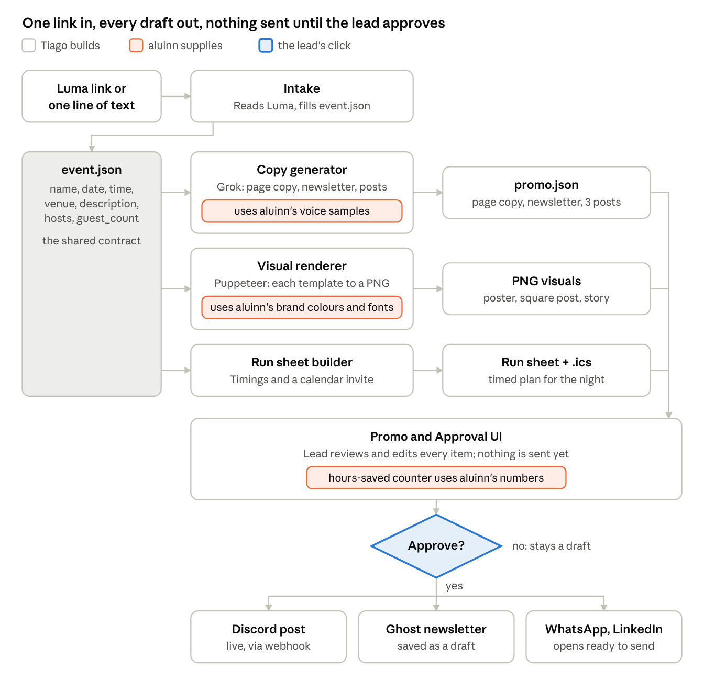
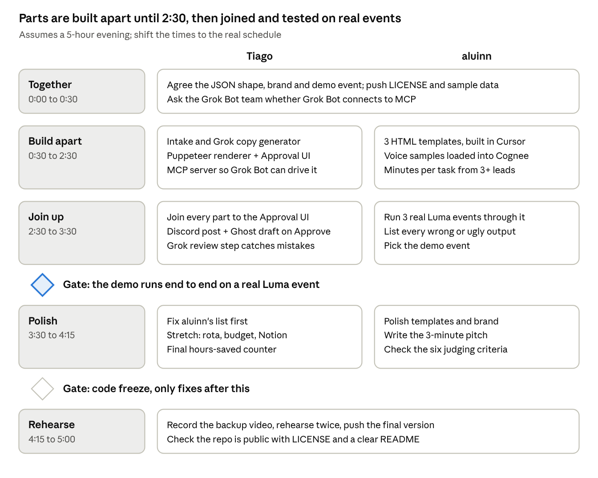

# Event Autopilot — Hackathon Game Plan

22 Oct 2026 · Tiago and aluinn · live, commentable copy: https://claude.ai/artifact/KqT18DQJGcZbFuwynZNYec

## The winning bet

We win by doing the judges' demo live on a real Luma event: paste a link, and in under two minutes the lead gets page copy, three posts, a newsletter draft, on-brand visuals and a run sheet, approves each one, and watches an hours-saved counter climb. Depth on that one path beats breadth across all four suggested features.

| Judging point | How we score on it |
| --- | --- |
| How much runs itself | One input (a Luma link or one line of text) produces every output. The lead's only job is to read and click Approve. |
| Quality of copy and visuals | Grok writes in the community's voice from its past Luma event descriptions. Visuals come from 3 designed HTML templates, so they always look on-brand. |
| Hours saved | A live counter on screen adds up the minutes saved per approved item, using numbers community leads give us on the night. |
| Would a lead trust it | Nothing is sent without Approve. Each post is previewed as it will look on WhatsApp, LinkedIn and Discord, and can be edited first. A log shows what was sent and when. |

**Built for real (the core):** Luma link to event.json, Grok copy to promo.json, Puppeteer visuals, a run sheet with a calendar invite, the Promo and Approval UI, the hours-saved counter.

**Real send on stage:** after Approve, post to a Discord channel (webhook) and create a Ghost newsletter draft. WhatsApp and LinkedIn open a ready-to-send message, which keeps us inside both platforms' rules.

**Only if time allows:** budget and volunteer rota, a Notion workspace mirror, a weekly Luma digest, a night-of check-in helper.

## Who does what

Tiago builds the engine behind the screen; aluinn owns the screen the lead uses (already started in the repo), plus the brand, the real-world numbers and the pitch. Each person owns separate folders, so you never edit the same file at the same time.

| Area | Owner | What "done" looks like | Folder |
| --- | --- | --- | --- |
| Promo and Approval UI (started) | aluinn | Platform-style previews, edit, Approve; shows the PNGs and hours saved | `promo-and-approval-ui/` |
| Event intake (Luma link or one line to event.json) | Tiago | Pasting any Luma link fills event.json correctly | `intake/` |
| Copy generator (Grok to promo.json) | Tiago | Page copy, newsletter and 3 posts in the community's voice | `copy-generator/` |
| Visual templates + Puppeteer renderer (done) | aluinn | 3 on-brand templates (square, wide, story) rendered to PNG | `promo-and-approval-ui/templates/` |
| Sponsor finder + outreach drafts | Tiago | 20 partners with public contact emails via Grok live search, one draft email each, never sent | `sponsors/` |
| Sending after Approve | Tiago | The UI's Approve button posts to Discord and creates the Ghost draft | `sending/` |
| Grok Bot + Cognee wiring (MCP server) | Tiago | Grok Bot can make, write and render an event by chat | `grok-bot/` |
| Run sheet + calendar invite | Tiago | Timed run sheet and an .ics file for the event | `run-sheet/` |
| Brand (colours, fonts, logo) | aluinn | Done: brand/brand.md and logo.svg | `CLAUDE.md`, `brand/` |
| Community voice samples | aluinn | 5-10 past event descriptions and posts, loaded into Cognee | `voice/` |
| Hours-saved numbers | aluinn | Minutes per task from 3+ real leads on the night | `data/hours.json` |
| Partner help on the night (Luma, Ghost, Notion, Grok) | aluinn | API keys and answers collected in the first hour | `.env` (never committed) |
| Pitch, demo event, backup video | aluinn, Tiago reviews | 3-minute script rehearsed twice; recording saved | `demo/` |

The templates only read from event.json, and the renderer takes any HTML file in `visuals/templates/` and turns it into a PNG, so a new template works without code changes. The UI only reads shared/promo.json and the PNGs, so aluinn can keep building it on the sample data while the engine is unfinished.

## How the pieces fit

Every part reads event.json and writes its own output, so the two of you can build in parallel and join the pieces at the end.



The lead's Approve click is the only path to sending; anything not approved stays a draft.

Folder layout, so each file has one obvious home:

```
shared/                 event.json, promo.json, hours.json (the contract)
promo-and-approval-ui/  aluinn's review and Approve screen
intake/                 Luma link or one line -> event.json
copy-generator/         Grok -> promo.json
promo-and-approval-ui/templates/  HTML/CSS templates + Puppeteer -> PNGs (aluinn)
run-sheet/              run sheet + .ics (hand-written, no library)
sponsors/               sponsor shortlist + outreach drafts (Grok live search)
sending/                runs only after Approve: Discord, Ghost, share links
grok-bot/               MCP server so Grok Bot can drive the pipeline
voice/                  past event texts, loaded into Cognee
brand/                  logo and fonts
demo/                   pitch script and backup recording
```

## Grok Bot at the centre

Grok Bot is the event's host partner, so it should do every step that needs judgement, not only the copy. Cognee gives it a memory of the community, so each event sounds more like the community than the last.

| Step | What Grok Bot does | Fallback if its access is limited tonight |
| --- | --- | --- |
| Intake | Turns a one-line idea or messy notes, quotes and receipts into a clean event.json | Read the Luma link with no AI step |
| Voice | Reads past events and posts saved in Cognee, then writes in that voice | Paste aluinn's voice samples into the prompt |
| Copy | Writes page copy, newsletter and the three posts into promo.json | None needed: this is the core |
| Visual words | Picks headline, tagline and colour variant for each template (no image models) | Templates use the event name as is |
| Run sheet | Drafts timings, volunteer roles and the budget from the notes | A fixed run-sheet template |
| Review | Checks every draft against event.json (wrong date, wrong venue) before the lead sees it | The lead checks by eye |
| Chat control | Lets the lead say "make the LinkedIn post shorter" or "what's left to approve?" | Edit in the UI |

**How to connect them:** run the pipeline as a small MCP server, a standard plug-in that lets an AI call our tools. Grok Bot can then call `make_event`, `write_promo` and `render_visuals` and ask what's waiting for approval. Cognee's MCP server plugs in the same way as its memory. The Approve click stays in the UI only, so Grok Bot can draft everything but never send.

**First thing to ask the Grok Bot team on the night:** does Grok Bot connect to MCP servers, or only to the xAI API? If only the API, we call Grok from our code and use Cognee directly; the table above still holds.

## Timeline for the evening

Build apart for two hours, then spend the second half joining, testing on real events and rehearsing.



If the first gate slips past 3:45, cut the stretch work and go straight to polish.

## Working in one repo without clashing

Two people can push to main all evening safely if each stays in their own folders and saves small, often.

1. **Stay in your folders.** The table above says who owns what. Need a change in the other person's folder? Ask in chat first.
2. **The two JSON files are the contract.** Agree their shape in the first 30 minutes, then don't change it without telling the other person (CLAUDE.md rule 1).
3. **Get the latest before you start, save small pieces often.** Before each push, run `git pull --rebase`, which fetches the other person's work first. Push every 30-45 minutes, not once at the end.
4. **Never force-push.** It can wipe out the other person's work.
5. **Sample data from minute one.** Done: aluinn's sample shared/event.json and shared/promo.json let each part be built before the others work.
6. **Secrets stay out of git.** API keys go in `.env`, which git ignores. Share keys in a private message, never in the repo.
7. **Licence first.** The repo carries the MIT `LICENSE` file, because judges check it.

## Demo script and hours saved

The 3-minute demo is one real event from link to sent posts, ending on the hours-saved number.

1. **The problem (20 s, aluinn):** "Every week a volunteer spends about [X] hours on the page, the visuals, the newsletter and the posts. We asked [N] leads tonight."
2. **One input (20 s, Tiago):** paste a real Luma link. event.json fills in on screen.
3. **Everything appears (40 s):** page copy, newsletter, WhatsApp, LinkedIn and Discord previews, 3 visuals and a run sheet, written in the community's own voice.
4. **The lead stays in control (40 s, aluinn):** edit one line in a post, then Approve. The Discord post lands live in a channel on screen, and the Ghost draft appears.
5. **The number (20 s):** the counter shows the hours saved for this event, then per volunteer per month.
6. **Close (20 s):** open source under MIT, here's the repo, one line on what comes next.

The counter needs a minutes-per-task baseline. These starting figures are **our own guesses** and must be replaced with leads' real answers on the night:

| Task done by hand | Our guess (minutes) |
| --- | --- |
| Event page copy | 45 |
| Visuals (poster and social cards) | 120 |
| Newsletter | 60 |
| WhatsApp, LinkedIn and Discord posts | 45 |
| Run sheet and calendar invite | 60 |
| **Total per event** | **330 (5.5 hours)** |

If the live demo breaks, play the backup recording and keep talking. Record it in the last hour, while everything still works.

## Decisions for the first 30 minutes

These block the build, so decide them together before splitting up.

- [x] **Brand:** done. brand/brand.md: dark #0B0B0F, orange accent #FF5A1F, text #F5F5F7, Space Grotesk + Inter, no gradients or shadows (aluinn)
- [ ] **Demo event:** which real Luma event we use, ideally one from a community whose lead is in the room (aluinn)
- [ ] **Grok API key:** who gets it, and from which partner on the night (aluinn)
- [ ] **Run sheet data:** CLAUDE.md says no new fields without asking. OK to add `run_sheet` to promo.json? Same question for keeping the voice samples in Cognee. (both)
- [ ] **Ghost:** use a free trial site or self-host for the live newsletter draft? (Tiago)
- [ ] **Discord:** create a test server and webhook for the live post on stage (Tiago)
- [ ] **The six judging criteria:** the brief mentions them but doesn't list them. Get them from the organisers and check the plan against them (aluinn)
